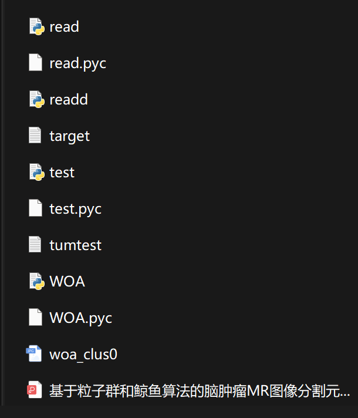

# Comparative Study of Brain Tumor MR Image Segmentation Metaheuristic Algorithms Based on Particle Swarm and Whale Optimization (Python Code Implementation)

Comparative Study of Brain Tumor MR Image Segmentation Metaheuristic Algorithms Based on Particle Swarm and Whale Optimization (Python Code Implementation)

## Images

<!-- PAYMENT_BLOCK -->

## Get this dataset

- Payment link (Stripe): [Buy now](https://buy.stripe.com/3cs8yP7sY87d0vu9AB)
- Payment QR code: 

<!-- /PAYMENT_BLOCK -->
